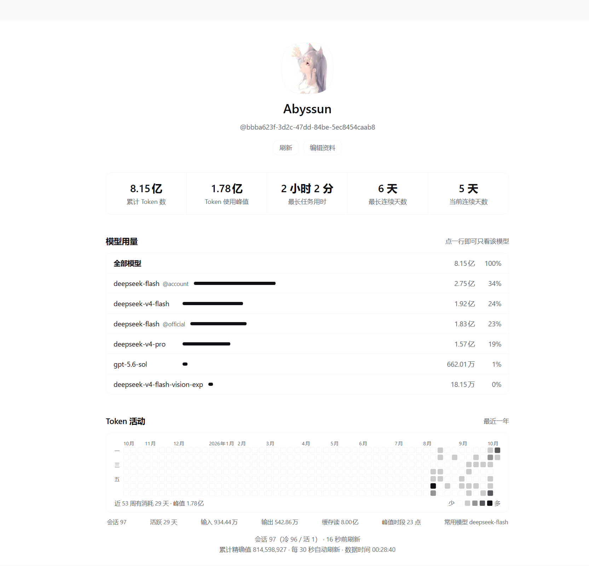

# dsh-achievements

为 [DeepSeek Harness（DSH）](https://github.com/deepseek-ai/deepseek-harness) Web UI 打造的**个人成就**插件：
左栏一个图标入口 → **一整页「个人主页」**，把历史 Token 用量摊成 5 张卡片，
下面跟模型用量分布与贡献热力图。



> 🤏 **小提示**：缩略值（如「8.15 亿」）看不出在动 —— 把鼠标停到卡片上会就地显示**逐位精确值**；
> 热力图的每一格悬停也会显示当天的精确用量。

> 与「设置页里的技术仪表盘」型 token 统计插件不同：本插件走的是 **`main` keyed 整页槽位**，
> 形态就是「个人主页」；与它们可以同时安装，槽位 id 不冲突。

## 功能

| 功能 | 说明 |
|---|---|
| 🖼 整页个人主页 | 头像 / 昵称 + 内联「编辑资料」表单 |
| 👤 默认取 DSH 账号 | 昵称与头像**默认用你登录 DSH 的账号**，自己改过就以你的为准 |
| 🗂 5 张卡片 | 累计 Token 数 · Token 使用峰值 · 最长任务用时 · 最长连续天数 · 当前连续天数 |
| 🧮 模型用量与筛选 | 每个模型的用量条与占比；**点一行即可只看该模型**（卡片与图表随之变化） |
| 🟦 贡献热力图 | 最近一年每日用量（GitHub 那种小方格），按当量分档深浅，悬停看精确值 |
| 🖼 头像上传 | 上传 PNG / JPEG / WebP / GIF，可拖动 + 缩放后裁成正方形 |
| 🧩 侧栏入口 | `sidebar.panellist` 图标，点击切到整页 |
| ⚙️ 设置页 | `settings.plugins.tab` 里同一套资料编辑器 |
| 🌗 主题 | 全部走 DSH 设计令牌（`--dsw-alias-*`），明暗自动跟随 |

## 安装

在应用内的**插件市场 / 插件管理**里，来源填：

```
github:Abyssun/dsh-achievements
```

或在 profile 目录里：

```bash
pnpm add "github:Abyssun/dsh-achievements"
```

**装完必须重启 DSH** —— 已安装插件没有热重载，Host 加载、typert 注册、
client bundle 注入都发生在启动时。重启后左栏出现一个奖杯图标，
点击后中间整页变成个人主页。

> 桌面应用（Electron）的 `desktop` profile 由应用独占管理，`dsh plugin` 命令会拒绝
> （`profile "desktop" is managed exclusively by the Electron application`），
> 这种情况请用应用内的插件市场/插件管理安装。

> ⚠️ **版本兼容门**：DSH 0.2.0 起会在安装时校验 `engines.dsh`（声明了它就由它单独决定，
> 否则校验**全部** `@deepseek-ai/dsh*` peer），不命中就**拒绝安装**并回滚，提示形如
> `Plugin <name>@<ver> is incompatible with dsh <runtime>`。
> 本插件声明覆盖 `0.1.5-rc.2` ~ `0.2.x`
> （`@deepseek-ai/dsh: ">=0.1.5-rc.2 <0.3.0"`、
> `@deepseek-ai/dsh-typert-protocol: "^0.1.5-rc.2 || ^0.2.0-rc.1"`），
> 并已逐项验证 **`0.2.1-rc.2`**（当前桌面版）可用。

## 使用

1. 点左栏奖杯图标 → 整页个人主页。
2. 首次打开会显示「正在后台扫描历史会话…」并逐步累加 —— 历史会话需要读一遍日志，
   完成后数字才是最终值。
3. **编辑资料**：改昵称、上传头像。留空即回退到 DSH 账号的昵称/头像。
4. **模型筛选**：在「模型用量」里点某个模型 → 卡片与图表只看它；再点一次取消。
   「最长任务用时」是会话级指标、没有模型维度，筛选时它仍是全局值。

## 指标口径

| 卡片 | 口径 |
|---|---|
| 累计 Token 数 | 全部会话的 `inputTokens + outputTokens + cacheReadTokens + cacheWriteTokens`。**计数互斥**（`inputTokens` 只含未缓存输入），`reasoningTokens` 是输出的一部分，**不重复计入** |
| Token 使用峰值 | 按**本地日历日**聚合后取最大的那一天 |
| 最长任务用时 | **空档切分**：相邻事件间隔 > 30 分钟即切成新的作业段，取最长的一段 |
| 最长连续天数 | 历史最长的「有 Token 消耗的本地日历日」连续段 |
| 当前连续天数 | 从今天往前数；今天没有消耗则从昨天起算（今天还没用不算断） |

**为什么「最长任务用时」不用「末事件 − 首事件」**：会话被恢复后会跨天甚至跨周，
那个口径会把「会话存续时间」当成「一次任务用时」，量级完全不对。
空档切分才是「一次连续作业」的时长。

**去重**：fork / 子会话的日志开头有一段**从父会话复制来的继承前缀**，
同一笔模型调用会出现在多份日志里。本插件按官方契约处理 ——
`ctx.sessionQuery.readSession()` 返回的快照直接带 `inheritedEventCount`，
用它跳过前缀，不自己解析标记。

## 已知限制

- **联网搜索的 Token 统计不到**：`web/deepseek-search-llm-request` 事件不带 `usage`。
- **数字会漂**：只要有新对话在写日志，聚合结果就会变。页面底部标注了「截至 …」。
- **每次启动都要重扫一遍历史会话**（十几秒到几十秒，视会话数而定）。
- 「最长任务用时」没有模型维度，筛选时仍为全局值。
- 头像裁剪是「正方形 + 拖动 / 缩放」，不是自由比例。

## 架构

```
main[keyed, key="dsh-achievements"]       整页个人主页
sidebar.panellist[id="dsh-achievements"]  左栏图标（id 必须 === main 的 key）
settings.plugins.tab                      资料编辑器
        ▲ ctx.remote.achievements（自挂载 $mount）
┌───────┴──────────────────────────────────────────────┐
│ Host: AchievementsService                            │
│  ① 投影单元 dsh-achievements.ledger（host-only）      │
│     框架负责订阅/水位线/持久检查点；init 拿到继承前缀长度 │
│  ② 跨会话 rollup（官方没有，本项目独有）                │
│     活会话 → registry.stateOf()；冷会话 → readSession() │
│     回填在后台跑（并发 4、每会话 8s 超时），           │
│     请求路径只读内存，并如实上报进度                    │
│  ③ Typert Remote（strict codec × create 工厂）        │
└──────────────────────────────────────────────────────┘
```

几个必须逐字一致的地方：`index.js` 的类名/服务键、`typert.host.js` 的
`model.services[].key`/`exportName`、`client.js` 的 `CLIENT_REMOTE` 描述符 id；
以及 `main` 的 key 与 `sidebar.panellist` 的 id。改动后跑 `npm run e2e`。

## 开发与测试

```bash
npm run check      # node --check 全部源文件
npm run smoke      # 离线冒烟（口径 / host 契约 / client bundle / manifest / 兼容门）
npm run e2e        # check + smoke
```

其中 `smoke:typert` 与 `smoke:compat` 需要解析**部署侧**的 `@deepseek-ai/*` 与 `semver`，
可通过环境变量指向部署的 `node_modules`。

## 发版

推 `v*` 标签即自动发版：CI 校验 → `npm pack` → 建 GitHub Release，
**Release 正文自动取用 `CHANGELOG.md` 里对应版本的段落**（缺段落会让发版失败）。
所以发版前要改两处：`package.json` 的 `version`，以及 `CHANGELOG.md` 里的一段 `## [x.y.z]`。
该段落只描述本次版本的改动，格式与语气见 `CHANGELOG.md` 顶部的「撰写约定」。

## License

[MIT](https://github.com/Abyssun/dsh-achievements?tab=MIT-1-ov-file)
